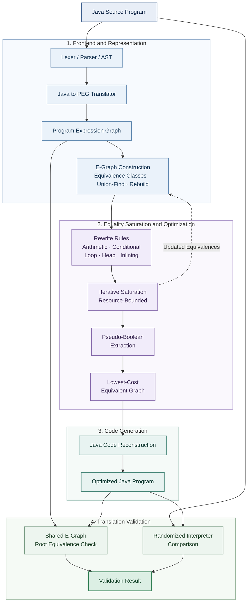

# Peggy Optimiser

An interactive compiler explorer that translates a supported Java source subset into PEG form, records equality-saturation steps, and compares them with destructive optimisation passes.

## Architecture



## Run

```powershell
cd backend
uv sync --extra dev
uv run uvicorn peggy.api.main:app --reload
```

The backend selects a compatible PuLP major version for the active Python: PuLP 3 on Python 3.10–3.11 and PuLP 4 with its CBC extra on Python 3.12+. If an existing environment reports that CBC cannot be executed, stop the API, run `uv sync --reinstall` from `backend/`, and restart it.

In another terminal:

```powershell
cd frontend
npm install
npm run dev
```

## Backend and frontend

`backend/peggy` separates the lexer/parser and AST, PEG translation, hash-consed union-find e-graph, rewrite families, saturation snapshots, PuLP/CBC extraction, traditional passes, validation, and FastAPI. The React/Vite frontend consumes only `/api` JSON through the Vite proxy. Sample programs live in `examples/`.

## Pipeline

The parser reads Java class and method wrappers, method parameters and calls, scalar assignments, branches, `while` and `for` loops, and simple array and field accesses. The PEG translator substitutes scalar definitions, merges branch values with φ, represents loop-carried scalars and heap state with θ/eval/pass, and threads a single σ heap through array/field operations and unknown calls. Pure, straight-line methods in the same class receive an inlining equality. The e-graph stores equalities with union-find and rebuilds congruence. PuLP sends a binary model to CBC for extraction. A separate ordered pass pipeline generates traditional snapshots.

## What this project does

Peggy Optimiser is an interactive Java source optimizer inspired by Tate, Stepp, Tatlock, and Lerner's equality-saturation work. Instead of committing to each rewrite immediately, it records equivalent expressions in a shared e-graph, then uses a binary optimization model to choose a low-cost representation. The workspace puts the traditional pass sequence and equality-saturation pipeline side by side, and reports graph growth, extraction statistics, generated Java, and validation evidence. Its parser focuses on Java methods using integer expressions, branches, loops, calls, and simple arrays or fields.
